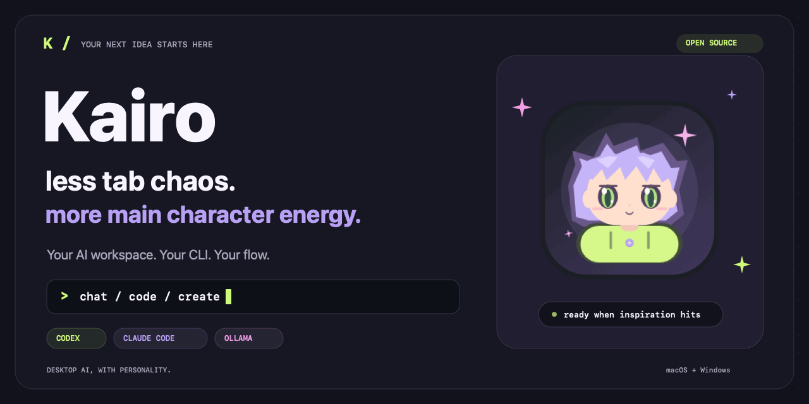

<div align="center">



# ✦ Kairo

**Your AI workspace. Your CLI. Your flow.**

Chat, code, and create with Codex, Claude Code, and optional local Ollama — in one desktop home with a little personality.

[](https://github.com/im-divxnshh/kairo-chat/actions/workflows/verify-build.yml)
[](LICENSE)
[](https://www.electronjs.org/)
[](https://nodejs.org/)
[](#-build-your-desktop-app)

[Get started](#-get-it-running) · [Features](#-the-good-stuff) · [Contribute](CONTRIBUTING.md) · [Report a bug](https://github.com/im-divxnshh/kairo-chat/issues/new?template=bug_report.yml)

<sub>Prefer a still image? <a href="docs/assets/kairo-hero.png">Open the static banner.</a></sub>

</div>

---

## 💜 Meet your new workspace

Your ideas deserve somewhere better than twelve tabs and a forgotten terminal.

Kairo brings AI conversations, project files, Git, prompts, and agent workflows into one Electron app. Keep using your own authenticated CLI providers, organize your work, and let the lime-and-lavender mascot handle the vibes.

**Early release: v0.2.1.** macOS and Windows are the packaging targets. Native desktop checks and some live integrations still need verification; see the [feature status](FEATURES.md) and [platform checklist](docs/USER_CHECKS.md). Linux installers are not configured.

## ✨ The good stuff

| Your next move | What Kairo brings |
| --- | --- |
| **Chat without losing the plot** | Streaming replies, conversation branches, edit/retry/stop, folders, tags, search, Markdown, code copying, and common LaTeX expressions. |
| **Bring your own AI** | Codex and Claude Code through their native CLIs; optional Ollama for local model inference. |
| **Give your ideas context** | Text, code, images, PDFs, project browsing, saved memory, prompt templates, and semantic ranking through your selected provider. |
| **Ship from one workspace** | Git actions, reviewed AI commit drafts, conflict-resolution previews, project terminals, and GitHub PR tools. |
| **Make agents do the group project** | Provider comparison, agent profiles, sequential workflows, collaboration, and stdio MCP tools. |
| **Pick up on another device** | Firebase accounts, user-scoped Firestore sync, a local cache/outbox, visible conflicts, private R2 attachments, and encrypted cloud backups. |
| **Make it feel like yours** | Appearance presets, native dictation, response speech, desktop alerts, and a blinking Dock/taskbar mascot with reduced-motion controls. |

The [full feature checklist](FEATURES.md) separates implemented behavior from outstanding setup and verification. Provider services and cloud resources may have their own costs.

## 🚀 Get it running

### 1. Bring the essentials

- **Node.js 22+** and npm. CI uses Node.js 24.
- **macOS or Windows** for the desktop targets.
- An installed, authenticated **Codex or Claude Code CLI**, or a running **Ollama** instance for local inference.
- Your own **Firebase project** with Email/Password Authentication and Cloud Firestore, or the Firebase emulators for local development.
- **Cloudflare R2 + the included Worker** for cloud attachments and backups. You can leave R2 unset for text-only emulator work.

On macOS, install Xcode Command Line Tools to compile the native PDF and speech helpers. On Windows, PDF text extraction requires Poppler's `pdftotext` on `PATH`; voice and terminal features depend on the available OS tools.

### 2. Clone and install

```sh
git clone https://github.com/im-divxnshh/kairo-chat.git
cd kairo-chat
npm ci
```

### 3. Open Kairo and connect your backend

```sh
npm start
```

On the sign-in screen, click **Set up my backend**. Enter your own Firebase web API key and project ID, plus the optional auth domain and app ID from Firebase Console → Project settings. Add your deployed R2 Worker URL for cloud attachments and backups.

Click **Save backend settings**, then sign in or create an account. Kairo remembers your configuration on this device and restores it whenever the app opens. **DMG/EXE installations use this same setup flow; no environment file or restart is required.**

Follow the [Firebase and R2 setup guide](docs/FIREBASE_R2_SETUP.md) to provision your own backend, deploy its rules and Worker, or configure the Firebase emulators. AI-provider authentication remains separate.

Developers can optionally use `.env.example` as an environment-file template. Saved in-app backend settings take precedence over environment cloud settings. `KAIRO_ACTIVE_PROVIDER` still optionally limits this device to `codex`, `claude`, or `ollama`.

On macOS, the `prestart` script builds the native helpers automatically. Once signed in, choose your provider and open a project.

## 🔐 Your workspace, explained

Kairo stores provider credentials in the providers' existing CLI configuration. Codex uses `config.toml`; Claude Code uses `settings.json`. Kairo invokes these CLIs for chat rather than making direct OpenAI API calls.

Conversations and workspace records sync through your Firebase project. Attachment objects live in your private R2 bucket behind an authenticated Worker. Local Ollama keeps model inference local; **it does not disable Firebase sync**. This is a cloud-connected app, and conversations are not end-to-end encrypted. Cloud backups use a separately configured encryption passphrase.

Chat uses disabled tools and Codex's read-only sandbox. Coding workflows ask for project-edit consent, and research can enable web tools. Projects synced from another device must be reopened locally before file and Git access is granted.

Temporary conversations are excluded from Firestore and backups. Scheduled tasks run while the app is open and signed in. Backup restoration depends on referenced R2 attachments remaining available.

See [development notes](docs/DEVELOPMENT.md) for MCP behavior, provider configuration, updates, and installed-app setup. Report vulnerabilities through the [security policy](SECURITY.md).

## 🛠️ Build your desktop app

| Target | Command | Output |
| --- | --- | --- |
| macOS, Apple Silicon | `npm run dist:mac:arm64` | DMG |
| macOS, Intel | `npm run dist:mac:x64` | DMG |
| Windows | `npm run dist:win` | NSIS EXE |
| Windows MSI | `npm run dist:win:msi` | MSI |

Build on the target operating system; generated installers go into `release/`. Prebuilt icons and installer artwork are included in `build/`. macOS helpers compile for the requested architecture before packaging.

The [GitHub Actions workflow](.github/workflows/verify-build.yml) checks the project on macOS and Windows, then builds **unsigned** installer artifacts. Successful builds appear in the workflow's artifacts; the workflow does not publish GitHub Releases. Signing, notarization, and native installation checks are still release work.

## 🧪 Keep the vibes verified

```sh
npm run check        # Syntax, HTML, branding, packaging, and feature metadata
npm test             # Local behavior tests
npm run progress     # Tracked implementation and verification status
```

Local tests cover conversation logic, CLI fixtures, DOM behavior, isolated Git operations, and cloud contracts. They do not establish live provider responses, production cloud access, native speech, or installer behavior. Use the [cloud setup guide](docs/FIREBASE_R2_SETUP.md) and [platform checklist](docs/USER_CHECKS.md) to verify those separately.

## 🗺️ Where we're heading

- Finish native macOS and Windows verification, including speech, accessibility, and installer flows.
- Verify remaining live Claude, GitHub, and research workflows.
- Prepare signed, notarized releases and a clearer download experience.
- Improve contributor onboarding, docs, and reproducible bug reports.

These are priorities, not release promises. [FEATURES.md](FEATURES.md) is the detailed status record; [issues](https://github.com/im-divxnshh/kairo-chat/issues) are the place to discuss the next steps.

## 🤝 Pull up. Build something.

First PR? Welcome. Useful contributions include setup-guide fixes, reproducible bugs, accessibility improvements, native-platform checks, and focused feature work.

Read [CONTRIBUTING.md](CONTRIBUTING.md), follow the [code of conduct](CODE_OF_CONDUCT.md), and use the [issue templates](https://github.com/im-divxnshh/kairo-chat/issues/new/choose) to give your idea enough context. Small, well-explained changes are a great start.

## 📚 The receipts

| Guide | What's inside |
| --- | --- |
| [Cloud setup](docs/FIREBASE_R2_SETUP.md) | Firebase, R2, environment variables, emulators, and live verification. |
| [Development notes](docs/DEVELOPMENT.md) | Project layout, provider behavior, MCP, updates, and packaged configuration. |
| [Feature status](FEATURES.md) | Implemented features and remaining verification work. |
| [API contract](docs/API_CONTRACT.md) | Firestore records, Worker endpoints, and verification boundaries. |
| [Branding](docs/BRANDING.md) | Mascot source, launcher animations, and installer artwork. |
| [Native checks](docs/USER_CHECKS.md) | Platform and live integration checks; includes historical maintainer notes. |
| [GitHub launch guide](docs/GITHUB_LAUNCH.md) | Repository description, topics, social preview, and first-push steps. |

## 📄 License

[MIT](LICENSE) © 2026 [im-divxnshh](https://github.com/im-divxnshh). Bundled third-party components retain their own licenses. Kairo is an independent project; provider names belong to their respective owners.

---

<div align="center">

**Built for the “wait, I have an idea” people.**

<sub>If Kairo helps your flow, a star helps someone else find it. ✦</sub>

</div>
